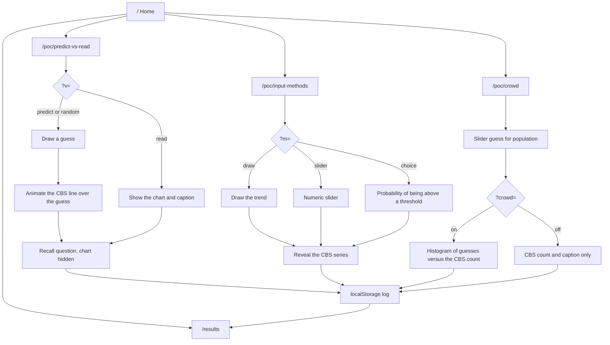
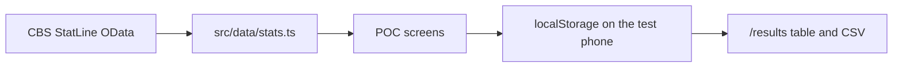

This is a [Next.js](https://nextjs.org) project bootstrapped with [`create-next-app`](https://nextjs.org/docs/app/api-reference/cli/create-next-app).

## Getting Started

First, run the development server:

```bash
npm run dev
# or
yarn dev
# or
pnpm dev
# or
bun dev
```

Open [http://localhost:3000](http://localhost:3000) with your browser to see the result.

You can start editing the page by modifying `app/page.tsx`. The page auto-updates as you edit the file.

This project uses [`next/font`](https://nextjs.org/docs/app/building-your-application/optimizing/fonts) to automatically optimize and load [Geist](https://vercel.com/font), a new font family for Vercel.

## Plotcall prototypes

School prototypes for a Fontys ICT Human Centered Design case study. Each route isolates one question for a phone test. Open the site on a phone (375px is the target width). Answers stay in `localStorage` on that phone. Collect them at [/results](http://localhost:3000/results), which shows a table and a CSV download. There is no backend.

Charts are hand-drawn SVG, not a chart library. The predict and draw tasks need a finger or pointer mapped onto data coordinates (the same idea as the New York Times “You Draw It” charts). A library chart would get in the way of that gesture, and skipping the dependency keeps the phone bundle small.

### What each prototype tests

| Route | Assumption under test | How to run it | What it logs |
| --- | --- | --- | --- |
| [/poc/predict-vs-read](http://localhost:3000/poc/predict-vs-read) | Guessing before the chart changes what people remember, compared with reading the chart first. | `?v=predict` or `?v=read`. If `v` is missing, the phone assigns one of the two at random and writes it into the URL. | Condition, the drawn line (predict only), time to lock the guess or to leave the chart, the recall answer, and time on the recall question. |
| [/poc/input-methods](http://localhost:3000/poc/input-methods) | The same bicycle question is usable as a drawn trend, a number slider, or a yes/no probability. | `?m=draw`, `?m=slider`, or `?m=choice`. The tabs set the same parameter. Switching method starts the timer again. | Method, the guess (line, number, or probability), and time to lock it in. |
| [/poc/crowd](http://localhost:3000/poc/crowd) | Seeing other guesses next to the real figure changes the story, compared with seeing only the figure. | `?crowd=on` or `?crowd=off`. The switch on the page sets the same parameter. The logged condition is the one active when the guess is locked in. | `crowd-on` or `crowd-off`, the number, and time to lock it in. |

The home page links to all three. “Session notes for the tester” at the bottom of each prototype repeats the parameters.

Crowd bars in pale gold are a **simulated crowd**: 22 fixed demo guesses in `src/data/stats.ts`, labelled on screen. They are not survey data and not CBS data. Dark bars are guesses saved on this phone. After 8 saved guesses, the simulated bars are hidden. Guesses do not sync between phones.

### Data

All chart figures were read from the CBS OData API on 7 October 2026 and checked against the story text in `src/data/stats.ts`. Nothing in the prototypes is a made-up statistic. There is no example-data badge because there are no placeholder series.

| Series | Used in | Table | What it is |
| --- | --- | --- | --- |
| Eindhoven existing-home sale prices, 2015–2025 | Predict vs read | [83625NED](https://opendata.cbs.nl/statline/#/CBS/nl/dataset/83625NED/table) | Average sale price in euros. Not a price index. |
| Bicycle kilometres per person, Netherlands, age 12+, 2018–2023 | Input methods | [84710NED](https://opendata.cbs.nl/statline/#/CBS/nl/dataset/84710NED/table) | ODiN, all trip purposes. 2024 is omitted because CBS still marks it provisional after a method break. |
| Eindhoven population on 1 January, 2015–2026 | Crowd | [03759ned](https://opendata.cbs.nl/statline/#/CBS/nl/dataset/03759ned/table) | Total population. CBS marks the table definitive. |

Swap a series by editing `src/data/stats.ts`. Each series has a source URL, table id, period, and retrieval date. If a replacement figure cannot be verified, set `placeholder: true` on that series. The screen will show an EXAMPLE DATA badge. Do not invent a number that looks official.

### Flow





## Learn More

To learn more about Next.js, take a look at the following resources:

- [Next.js Documentation](https://nextjs.org/docs) - learn about Next.js features and API.
- [Learn Next.js](https://nextjs.org/learn) - an interactive Next.js tutorial.

You can check out [the Next.js GitHub repository](https://github.com/vercel/next.js) - your feedback and contributions are welcome!

## Deploy on Vercel

The easiest way to deploy your Next.js app is to use the [Vercel Platform](https://vercel.com/new?utm_medium=default-template&filter=next.js&utm_source=create-next-app&utm_campaign=create-next-app-readme) from the creators of Next.js.

Check out our [Next.js deployment documentation](https://nextjs.org/docs/app/building-your-application/deploying) for more details.
